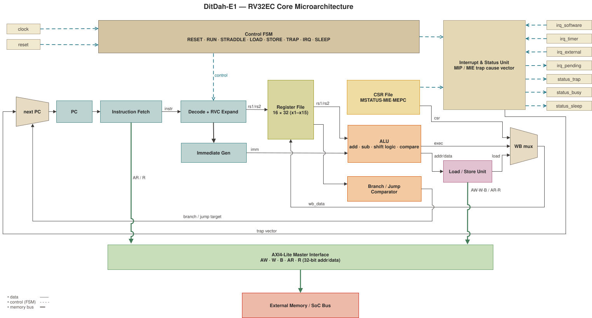

# DitDah-E1

DitDah-E1 is a compact, two-stage RV32EC RISC-V core for always-on controllers and PHY control.
It combines 16 integer registers, machine-mode traps, a shared AXI4-Lite memory port, and optional JTAG debug.

Formerly DitDah32, the core belongs to the DitDah embedded series: E identifies the role, and 1 identifies the architecture generation.

## Features

| Component | Implementation |
| --- | --- |
| ISA | RV32E, Zca compressed instructions, Zicsr |
| Pipeline | Two stages, in-order, single issue |
| Registers | 16 integer registers, 32 bits each |
| Privilege | Machine mode, direct traps, MRET, WFI |
| Interrupts | Machine software, timer, and external interrupts |
| Memory | One shared, single-beat AXI4-Lite master port |
| Debug | Optional single-hart RISC-V Debug v1.0 subset over JTAG |

The core has no hardware multiply/divide, atomics, floating point, vectors, caches, MMU, PMP, or supervisor/user modes.
Debug excludes authentication, triggers, Program Buffer, system bus access, and multi-hart operation.

JTAG is disabled by default. Integration must secure an enabled debug port and replace the placeholder `jtagIdcode` before hardware release.

[](doc/microarchitecture.md)

## Results

The v1.4.0 no-JTAG baseline completed layout DRC/LVS signoff in TSMC 16FFCLL with 9-track cells.
Its area is 14.3 kGE, or 2219 um^2 of standard cells.
The current toolchain regenerates the top-level netlist; that netlist has not completed physical signoff.

| Corner | Fmax | Dynamic (CoreMark) | Leakage |
| --- | ---: | ---: | ---: |
| SS 0.72 V 125 C, signoff | 314 MHz | 0.63 uW/MHz | 6.2 uW |
| TT 0.80 V 25 C, typical | 455 MHz | 0.76 uW/MHz | 0.4 uW |
| TT 0.55 V 25 C, near-threshold | 146 MHz | 0.33 uW/MHz | 0.2 uW |

Timing uses post-layout STA at typical RC, with the worst path from an AXI input to a register.
Dynamic power uses CoreMark activity.

Performance below uses RTL cycle counts and is not EEMBC-certified.

| Memory model | CoreMark/MHz | DMIPS/MHz |
| --- | ---: | ---: |
| 0-wait TCM (intrinsic) | 0.289 | 0.163 |
| AXI-Lite, 2 wait-states | 0.144 | 0.081 |

Run `make bench-score` or `nix run .#score` to reproduce the benchmark estimates.

## Build

```bash
nix build .#default --no-link
nix develop
build-ditdah-e1          # production RTL
build-ditdah-e1 --trace  # verification trace ports
build-ditdah-e1 --jtag   # optional debug ports
```

The default build omits trace and JTAG ports. Pipeline and interface contracts are in [microarchitecture.md](doc/microarchitecture.md).

## Verify

```bash
make test-model            # reference model
make test-isa              # directed ISA artifacts
make verify-smoke          # fast push/PR gate
make verify-rvfi           # implemented-profile RVFI proofs
make verify-compliance     # compliance signatures
make verify-signoff        # CPU/JTAG campaign; compliance is separate
make test-jtag             # JTAG and OpenOCD/GDB integration
```

Verification combines directed RTL tests, differential instruction traces, formal properties, compliance signatures, and coverage.
Reports land under `result/`; [verification.md](doc/verification.md) records pass criteria and [open_gaps.md](doc/open_gaps.md) records limits.

## Release

`make package-release RELEASE_TAG=vX.Y.Z` creates trace-free RTL archives with a manifest, filelist, and license.
Variants cover the default core, optional JTAG, and an Anlogic EG4 FPGA register file with an SDC template.

## Credits

Independent RTL implementation with verification and tooling informed by these projects:

- [Ibex](https://github.com/lowRISC/ibex) and its demo system: core/debug boundary, OpenOCD integration, and verification methodology.
- [PicoRV32](https://github.com/YosysHQ/picorv32): practical Verilog testbench, RVFI and riscv-formal integration as a reference pattern.
- [Rocket Chip](https://github.com/chipsalliance/rocket-chip): configurable JTAG DTM handshake and reset behavior.
- [RISC-V Debug Specification](https://github.com/riscv/riscv-debug-spec): JTAG DTM, DMI, Debug Module, abstract command, and run-control contracts.
- [riscv-formal](https://github.com/YosysHQ/riscv-formal): RVFI specification, property-group framework, and the NERV reference implementation.
- [T1](https://github.com/chipsalliance/t1): Nix-driven artifact, build, run, and check separation.
- [riscv-arch-test](https://github.com/riscv-non-isa/riscv-arch-test): compile, run, dump, compare signature convention.
- [Spike](https://github.com/riscv-software-src/riscv-isa-sim) and [Sail-RISCV](https://github.com/riscv/sail-riscv): reference ISS models for differential testing and compliance signatures.
- [Zaozi](https://github.com/vowstar/uart_zaozi): Chisel and Nix project layout reference.
