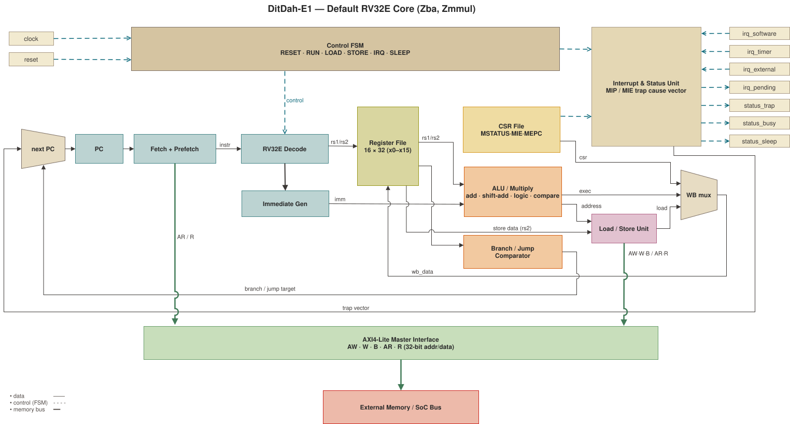

# DitDah-E1

DitDah-E1 (formerly DitDah32) is a two-stage, single-issue RV32E processor for always-on controllers and PHY control. It has 16 integer registers and one AXI4-Lite port for instructions and data.

<p align="center">
  <a href="https://github.com/vowstar/ditdah-e1/issues/2#issuecomment-7005801650"></a>
</p>

| Default core on 7 nm | Result |
| --- | ---: |
| Routed standard-cell area | 1,043.962 µm² |
| Shortest passing clock period at 0.75 V, 25 °C (typical) | 1.450 ns |
| Core power at 500 MHz, excluding external memory | 569.5 µW |
| One validated CoreMark iteration, zero memory wait states | 727,703 cycles |

Timing uses parasitics extracted after metal fill. The power estimate uses switching activity from the validated CoreMark iteration in gate-level simulation. [Layout and measurements](https://github.com/vowstar/ditdah-e1/issues/2#issuecomment-7005801650) · [Earlier layout with C disabled](https://github.com/vowstar/ditdah-e1/issues/2#issuecomment-6982396350)

## Microarchitecture

[](doc/microarchitecture.md)

| Build profile | Instruction set | Instruction fetch |
| --- | --- | --- |
| Default | RV32E, Zicsr, compressed instructions (Zca), Zba, Zmmul | Sequential word prefetch in the aligned 64 KiB window containing the reset vector |
| Minimal | RV32E, Zicsr | Demand reads only |

Both profiles use the `ilp32e` ABI and support machine-mode traps, software, timer and external interrupts, MRET and WFI. Map the default prefetch window to executable memory with side-effect-free reads. [Instruction set](doc/instruction_table.md) · [Microarchitecture](doc/microarchitecture.md)

## Build and verify

```sh
nix develop
OUTPUT_DIR=result/production build-ditdah-e1
OUTPUT_DIR=result/minimal build-ditdah-e1 --minimal
make verify-smoke
make verify-signoff
```

`--no-c` disables only compressed instructions. Use `--minimal --c` for compressed instructions on the minimal core. Enable `FENCE.I` with `--zifencei`. Use `--jtag` for the single-hart RISC-V Debug 1.0 subset. Secure the debug port and set a device ID with `--jtag-idcode ID`. [Verification](doc/verification.md) · [Debug support and limits](doc/open_gaps.md)

## RTL releases

Version tags built from this revision produce four trace-free SystemVerilog archives. The unsuffixed archive contains the default core. Choose `-minimal` for the smallest feature set, `-jtag` for the default core with debug, or `-fpga` for the default core with an Anlogic EG4 register file. Each archive includes `filelist.f`. In v1.6.0 the standard core enables C only among these options, and the separate `-mul-prefetch` archive disables C. [v1.6.0 downloads](https://github.com/vowstar/ditdah-e1/releases/tag/v1.6.0)

For EG4, replace `DitDahE1Gpr.sv` in the filelist with `fpga/DitDahE1Gpr.v` and supply the `EG_LOGIC_DRAM` primitive.

## License

The project uses the [MIT license](LICENSE). Vendored components retain their [upstream licenses](doc/third_party.md).

## Credits

- Core and debug design draws on [DitDah-E2](https://github.com/vowstar/ditdah-e2), [Ibex](https://github.com/lowRISC/ibex), [Rocket Chip](https://github.com/chipsalliance/rocket-chip) and the [RISC-V Debug Specification](https://github.com/riscv/riscv-debug-spec).
- Verification draws on [PicoRV32](https://github.com/YosysHQ/picorv32), [riscv-formal and NERV](https://github.com/YosysHQ/riscv-formal), [riscv-arch-test](https://github.com/riscv-non-isa/riscv-arch-test), [Spike](https://github.com/riscv-software-src/riscv-isa-sim) and [Sail-RISCV](https://github.com/riscv/sail-riscv).
- The hardware generator and toolchain use [Zaozi](https://github.com/xinpian-tech/zaozi), [LLVM](https://github.com/llvm/llvm-project) and [CIRCT](https://github.com/llvm/circt). Build and packaging draw on [T1](https://github.com/chipsalliance/t1), [UART_Zaozi](https://github.com/vowstar/uart_zaozi) and [mvn-trace-forge](https://github.com/Avimitin/mvn-trace-forge).
